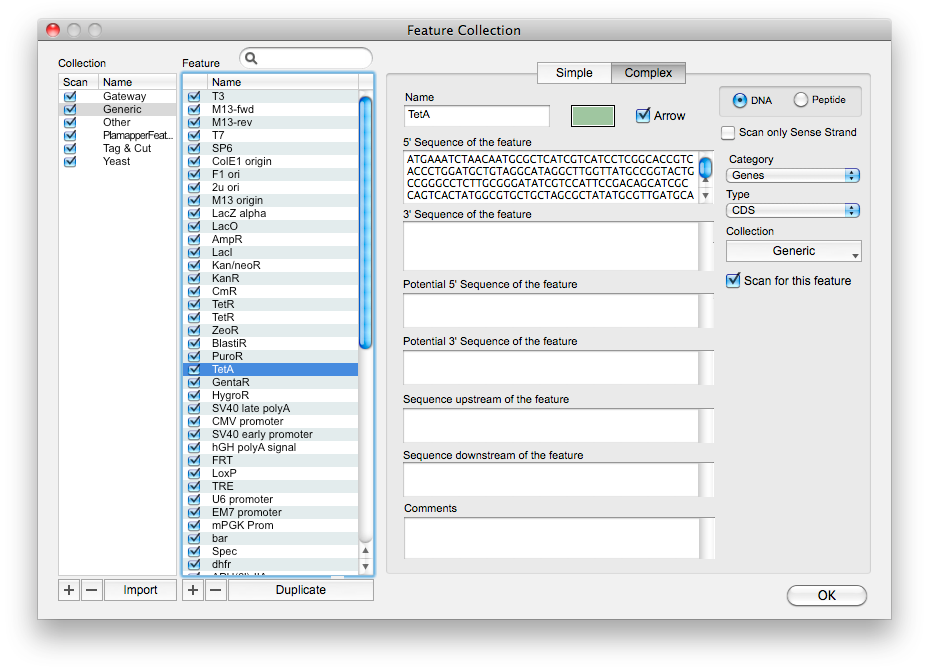

# Features

Annotations — origins, genes, promoters, tags, att sites — drawn on the maps and coloured in the
sequence field. They are stored in `.xdna` files (Serial Cloner's extension of the DNA Strider
format) and in GenBank exports with their colours.

## The Features tab

| Control | Behaviour |
|---|---|
| **Edit / Done** | Toggles between the protected mode and the Edit mode. |
| List | Show checkbox, name, type, from, to, strand, colour. Shown Features are in bold. Double-click selects the Feature's bases. In Edit mode: click to edit, **drag to reorder** — the list order is the drawing order, which matters when Features overlap. |
| **Show** | Alt-click a Show checkbox to show or hide **all** Features. **S** toggles the display while the tab is active. |
| **+** | Adds a Feature. The current selection gives its coordinates; with the Info panel shown, the translation goes into the comments. Also Features ▸ New Feature From Selection (⌘⇧2) and the context menu of the sequence field. |
| **−** | Deletes the selected Feature after confirmation. Press **Alt** first: the button turns red and deletes without asking — handy for many deletions. Edit ▸ Undo brings a Feature back. |
| **Scan** | See below. |
| **Manage…** | Opens the Feature Collection window. |
| Editor | Name, type (GenBank key), first and last base *in the direction of the Feature*, CW / CCW, Show, Arrow, colour, comments (`qualifier=value` lines become GenBank qualifiers on export). **Apply** saves. |

Coordinates follow Serial Cloner's convention: `start` is the Feature's 5' end in its own
direction, so a reverse Feature has `start > end`, and a forward Feature crossing the origin of
a circular plasmid has `start > end` too.

Any Feature you add or edit becomes **protected**: a later scan will not replace it.

## Scanning

Features ▸ Scan Sequence (⌥⌘S), the Toolbar's **Scan** or the tab's button looks for every enabled
definition of every enabled Collection, on both strands (unless a definition is sense-only),
across the origin of circular sequences. Hits are merged the way the original did: an unprotected
Feature identical to a hit is replaced; a protected one is kept and the hit is not duplicated.
Features ▸ **Remove duplicated Features** cleans up afterwards. Protein windows scan for the
peptide definitions (Tags & Cut).

## Definitions

A **simple** definition is one consensus: DNA (IUPAC codes allowed) or a peptide, matched against
the translation of both strands in the three frames.

A **complex** definition has:

- a **5' sequence** and a **3' sequence** — anything between them belongs to the Feature;
- **potential 5' / 3' sequences** — included when present (the START and STOP codons of EGFP,
  which are there for an untagged protein and absent in a fusion);
- **upstream / downstream sequences** — required for the Feature to be scored but not part of it
  (a cysteine only when followed by `VLL`).

## Manage Features

<figure markdown>

<figcaption>The Feature Collection window (original screenshot): Collections, their Features, and the Simple / Complex editor.</figcaption>
</figure>

Collections on the left (the **Scan** checkbox says whether a Collection is used; unselect the
ones you never need to speed scans up), Features of the selected Collection in the middle (with a
search field and their own Scan checkboxes), the editor on the right: Simple / Complex tabs, DNA or
Peptide, *Scan only Sense Strand*, Type, the Collection a Feature belongs to, *Scan for this
feature*, colour, arrow, comments. **+**, **−** (Alt: no confirmation) and **Duplicate** manage
Features; **+**, **−** and **Import** manage Collections; hold **Alt** and Import becomes
**Export** (SerialClon JSON or a generic table). **Restore built-in** puts the shipped
Collections back without touching yours. **OK** saves everything.

Import accepts three formats: SerialClon JSON, a generic tab-separated table
(`name  sequence  type  colour  DNA|Peptide`) and ApE feature files.

## The built-in Collections

Generic, Yeast, Other, Tags & Cut and Gateway — 131 of the original's 150 names, every one
reconstructed from a public record or a shipped sample file. See [Data](../data.md) for the
provenance and the list of the 19 that could not be verified.
