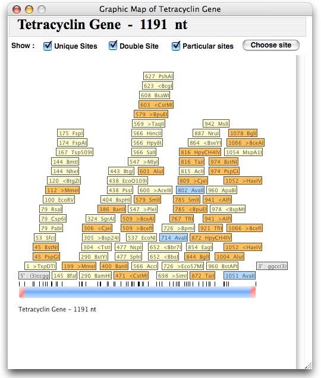

# Graphic Map

Restriction ▸ Graphic Map (⌘G), the Sequence Window's button, or the Toolbar. One map per
Sequence Window; it follows every edit of the sequence.

<figure markdown>

<figcaption>Linear map (original screenshot): unique sites in yellow, double sites in orange, a particular site in blue; cohesive ends drawn in red with the overhang sequence in a grey box.</figcaption>
</figure>

## Controls

| Control | Effect |
|---|---|
| **Features** | Show the sequence's Features as arcs (circular) or boxes (linear) with arrowheads and name boxes. |
| **Unique Sites** | Enzymes cutting once (yellow). |
| **Double Site** | Enzymes cutting twice (orange). |
| **Particular sites** + **Choose site** | Any list of enzymes (blue). The chooser lists the library with unique sites in bold and absent ones in italic; type to jump; *Unselect all* clears; *Use previous selection* re-uses the last list. |
| ⌂ | Brings the parent Sequence Window to the front (Alt-click on the map does the same). |

Site labels read `position Name` — the position is the first base of the recognition site, as the
original printed it — with a `>` or `<` for enzymes whose orientation matters. **Drag** any label
to arrange the figure; the leader line follows.

## Selecting a fragment

1. Click a site's name box: it turns **green** — the BEGIN site.
2. Double-click or shift-click another: it turns **red** — the END site.
3. **Spacebar** toggles the direction: clockwise / counter-clockwise on a circle, sense / antisense
   on a linear map (the current direction is shown top right). On a circle a single site is enough:
   the fragment is the whole linearised plasmid with that site's cohesive ends.
4. `A` selects a whole linear insert; **Delete**, Backspace or Escape cancel.
5. **Extract Fragment** (⌘6, the Toolbar or the context menu) opens the fragment in a new Sequence
   Window with its cohesive ends and a provenance comment; the Features inside come along.
   **Make New Feature** creates a Feature spanning the two sites; **Use Selection in Build a
   Construct** sends it to the cloning window.

## Context menu

Linearize / Circularize, Save Graphic Map As… (PNG, also File ▸ Save As on the map), Print…,
Extract Fragment, Make New Feature, the direction toggle, Cancel Selection, Show Sequence Window.

## Feature labels

A click on a Feature name box selects the Feature on the map; a double-click selects its bases in
the parent Sequence Window.
