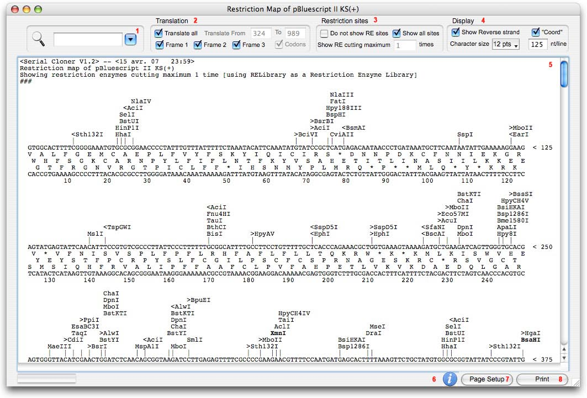

# Sequence Map

Restriction ▸ Sequence Map (⌘M), the Sequence Window's button, or the Toolbar. The text
restriction map with multi-frame translation, in the exact layout the original printed — verified
line for line against a map printed by Serial Cloner 2.1.

<figure markdown>

<figcaption>The Sequence Map (original screenshot) and its four control panels.</figcaption>
</figure>

## Panels

**Search** — a nucleotide string, amino acids separated by two spaces (`V  A  L`, three in codon
mode) or an enzyme picked from the list; Return or the magnifying glass finds the next
occurrence, wrapping at the end of the map.

**Translation** — *Translate all*, or *From … To …* (prefilled with the Sequence Window's
selection when the map was opened from one); frames 1, 2 and 3; **Codons** (a single frame,
the bases grouped by codon); *Uppercase only* translates only upper-case bases.

**Restriction sites** — *Do not show RE sites*, *Show all sites*, *Show RE cutting maximum n
times*, or a particular list (**Choose…**).

**Display** — *Show Reverse strand*, *Coord* (the coordinate line every ten bases), character
size, nucleotides per line; **Features** adds `>` / `<` labels at each Feature's midpoint and a
legend at the end.

## Layout

Per block: the site labels stacked above a line of `|` marks (labels that would collide move up
a row; oriented enzymes carry `>` or `<`), the top strand ending in `< position`, one translation
line per frame with each amino acid under the first base of its codon, the reverse strand, the
coordinates. The header names the enzyme library and the filter; the legend lists every Feature
as `name : [start : end - CW|CCW]`.

Select and copy any part of the map with the Edit menu; **Print** uses a landscape-friendly
stylesheet (8 pt and 100 nt per line fit a page).
